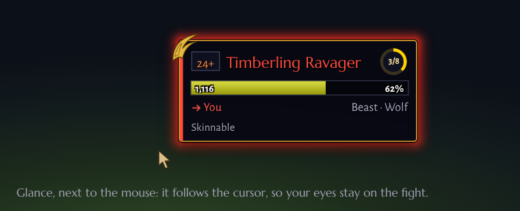
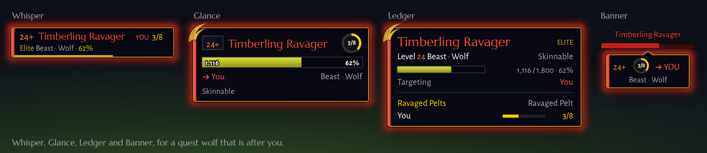
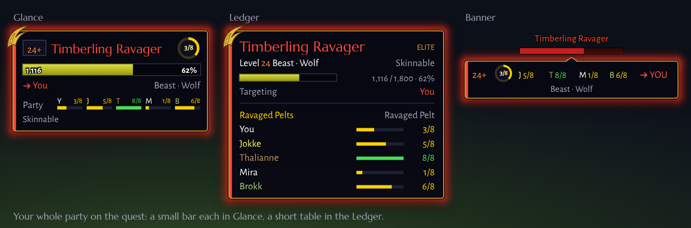
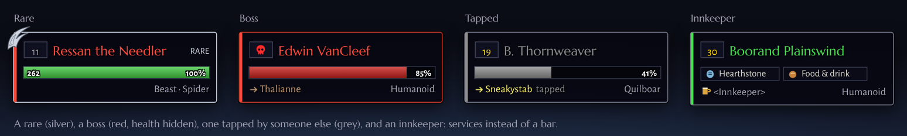
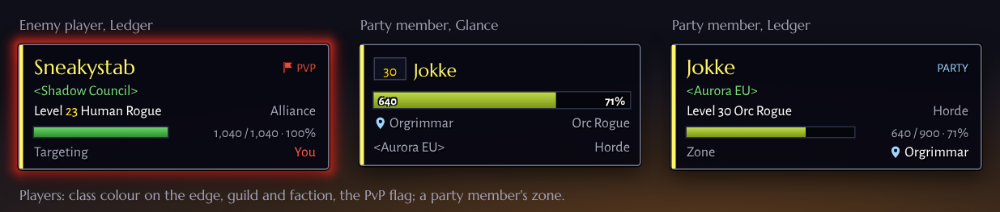
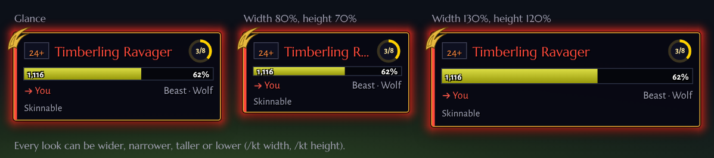
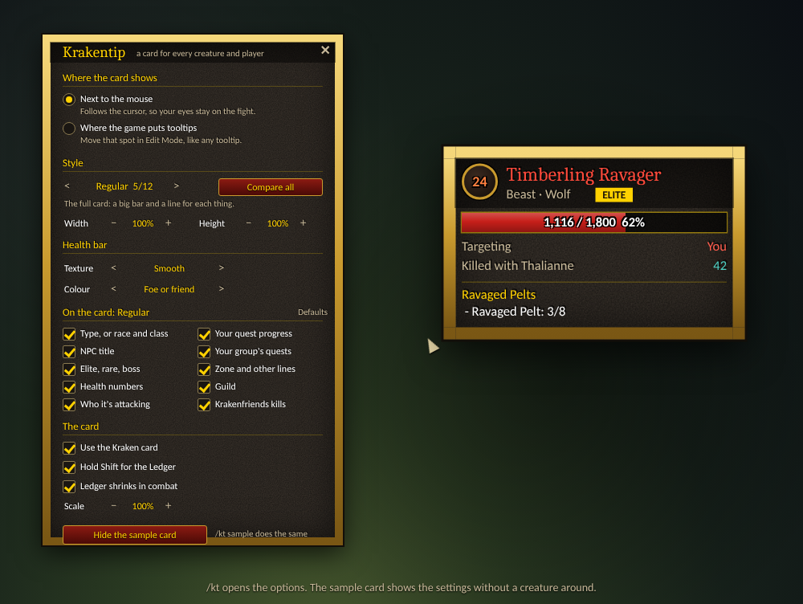

# Krakentip

Creatures and players get a card in the look of the game's own tooltips instead of the game's unit tooltip, for **World of Warcraft: Forever**, like the rest of the Kraken family. Friend or foe, NPC or player: every unit gets the card. **Every other tooltip stays as it is**: items, spells, menus, buttons and bags keep the game's tooltip.

## Four looks, one family

Designed from a blank page: the concept is [docs/clean-slate.html](docs/clean-slate.html) (the "Krakentip Clean Slate" artifact), and [docs/cards.html](docs/cards.html) shows the same units as the addon draws them. Every look carries what the game's own tooltip gives: name, level, type (race and class), elite, rare or boss, health, quest progress and who it's after; guild, faction and PvP for players; the title for NPCs. The small looks write it shorter; none leaves it out.

| Look | For | What it shows |
| --- | --- | --- |
| **Whisper** | Players who barely want a tooltip | Two short lines at the cursor: level, name, YOU when it's after you, your quest count, the PvP flag; then rank and type, guild, health, the target, a party member's zone, your party's counts (J5 T8). A health line along the bottom edge. |
| **Glance** (the default) | Combat, grinding, dungeons | Level in its box, name and the quest ring; the bar with the number and the percentage; the target and the type; guild and faction for players; a small bar with a count for each party member on the quest. |
| **Ledger** | Questing, towns, other players | The full read, like the game's item tooltips: every line, with the party's quest as a short table (You 3/8, Jokke 5/8, ...). |
| **Banner** | Playing with nameplates on | Hangs under the creature's nameplate, which already shows name and health: level, rank, quest ring, the party's counts and the target, with the type below. Without a nameplate (nameplates off, a unit frame, a party member far away) it's Glance at the cursor. |

### How they work together

- **Hold Shift for the Ledger.** While you hold Shift, any look becomes the Ledger. Let go and your look comes back. (`/kt shift`)
- **The Ledger shrinks in combat.** When your look is the Ledger, it's Glance while you fight. (`/kt combat`)

Both are on by default. Switch looks with `/kt whisper`, `/kt glance`, `/kt ledger` or `/kt banner`, step through them in the options (< and >), or right-click the minimap button. `/kt compare` (or **Compare all** in the options, or shift-click the minimap button) shows all four side by side: a sample wolf until you hover a unit, then that unit. Click a look to use it.

## The rules they share

- **The edge says who it is to you.** A coloured stripe on the left: red hostile, yellow neutral, green friendly, grey tapped by someone else. Players get their class colour.
- **The frame says what kind.** Gold with a gold wing for elites, silver with a silver wing for rares, red with a skull for bosses. On the small looks a + after the level means elite.
- **The level's colour says how hard**, in the game's own colours: grey trivial, green easy, yellow even, orange hard, red very hard. No words needed.
- **A red glow when it's after you.** The frame breathes red while the unit is attacking you.
- **Everything has its place.** Level top left, quest top right, health in the middle, the target below it. When something is missing its space closes, but nothing swaps places.
- **The quest ring** fills as you go: gold, and green when you're done.
- **Friends get different questions.** NPCs that sell, train or fly you show what they do (Hearthstone, Food & drink, Flights, Bank, Training, ...) instead of a health bar, read from their English title, and their name loses the title the role already says ("Boorand Plainswind", the innkeeper). A party member somewhere else shows where they are.

## What's on the card

Each look has its own list of what it shows, in the options under **On the card**, with a **Defaults** button to put it back: type (or race and class), NPC title, elite/rare/boss, health numbers, who it's attacking, your quest progress, your group's quests, zone and other lines, guild, Krakenfriends kills. The name, the level and the bar always show; by default every look shows everything. `/kt show group` switches one field of the look in use.

- **Other lines** are what else the game's tooltip says, like "Skinnable" on a corpse. Glance and the Ledger show them; Whisper and Banner keep to the essentials (a party member's zone still shows).
- **Killed with your friend**: with [Krakenfriends](https://github.com/Krakenhood/krakenfriends) loaded, how often you two have killed this creature. It only shows when Krakenfriends is loaded and you've killed it together.

The card keeps itself up to date while you hover: health, who it's attacking, dead or tagged.

## Width, height and the bar

Each look has its own **width** and **height** (60% to 160%), in the options or with `/kt width 0.8` and `/kt height 1.2` for the look in use. **Scale** makes the whole card bigger or smaller.

The **health bar** has a texture (Slate, the default, flat with a shine; Smooth, Flat, Raid, Skill bar) and a colour: by health (green, to yellow, to red as it drops; the default), foe or friend (red for what you can attack, green for the rest) or gold.

## Where it shows

- **Next to the mouse** (`/kt mouse`, the default). The card follows the cursor, so your eyes stay on the fight. Near the right edge of the screen it flips to the left of the cursor.
- **Where the game puts tooltips** (`/kt tooltip`). Move that spot in Edit Mode, like any tooltip.
- **Banner** always hangs under the nameplate, whichever you pick.

**Action targeting**: when you face a creature and the game picks it as your soft target, Krakentip shows its card at the tooltip spot, and it goes when you face something else.

## Options

`/kt` opens the options window: where the card shows, its look, that look's width and height, the health bar, what's on the card, Shift and combat, and the scale. It's also under Options > AddOns > Krakentip, and the minimap button opens it (click; right-click switches the look, shift-click opens Compare).

**Show a sample card** puts a pretend Timberling Ravager on screen, so you can try the position, the look, the size and the lines without a creature around.

## How it works

The game builds unit tooltips (creatures and players) on their own path, apart from the tooltips for items, spells, menus and buttons. Krakentip only steps in on that path: the game's unit tooltip is hidden before it's drawn, and the card shows instead. The moment the game's tooltip is taken for anything else, it's left alone, so nothing else can look different.

The wing, the quest ring, the glow, the Banner's notch and the small icons in the text (the target arrow, the PvP flag, the zone pin) are the addon's own textures in `media/`, drawn from the concept page's shapes by `tools/media.js`. The skull and the NPC icons are the game's.

**Secret values**: Forever can hide some numbers from addons, an enemy's health in particular. The health bar still fills, because the game lets status bars show hidden numbers, and the percentage is written by the game itself. Lines that need a hidden value are left out.

## Commands

| Command | What it does |
| --- | --- |
| `/kt` | Open or close the options |
| `/kt whisper`, `/kt glance`, `/kt ledger`, `/kt banner` | Use that look |
| `/kt style` | Switch to the next look |
| `/kt styles` | List the four looks |
| `/kt compare` | All four side by side; hover a unit to fill them |
| `/kt shift` | Holding Shift opens the Ledger, or not |
| `/kt combat` | The Ledger shrinks to Glance in combat, or not |
| `/kt mouse` | Show the card next to the mouse |
| `/kt tooltip` | Show the card where the game puts tooltips |
| `/kt width 0.8` | This look's width (0.6 to 1.6) |
| `/kt height 1.2` | This look's height (0.6 to 1.6) |
| `/kt show group` | Show or hide a field on this look: type, title, rank, health, target, quests, group, other, guild, friends |
| `/kt bar flat` | The bar's texture: slate, smooth, flat, raid, skill (no name: the next one) |
| `/kt barcolor reaction` | The bar's colour: health, reaction, gold |
| `/kt scale 1.2` | Make the card bigger or smaller (0.6 to 1.6) |
| `/kt sample` | Show or hide the sample card |
| `/kt blizzard` | Switch between the card and the game's own unit tooltips |
| `/kt minimap` | Show or hide the minimap button |
| `/kt fonts` | Which font file each alphabet (Latin, Cyrillic, Korean, Chinese) gets |

## Install

Unzip `Krakentip-<version>.zip` into the game's `Interface\AddOns` folder, so that you have `Interface\AddOns\Krakentip\Krakentip.toc` and `Interface\AddOns\Krakentip\media\`. Or copy this repository's addon files (the `.lua` files, `Krakentip.toc` and `media/`) into a folder named `Krakentip` there. `python3 tools/package.py` builds the zip into `dist/`.

Coming from 0.7: your look becomes Glance unless it was already one of these four, and the bar takes the Slate texture and the health colour. The twelve looks of 0.7 (Regular, Mid, Minimal, Classic, Plate, Portrait, Bar, Icons and the first Slate four) are kept on the [`legacy` branch](https://github.com/Krakenhood/krakentip/tree/legacy).

## Development

- `cd tests && npm install && npm test` runs the addon headless against a mock of the game.
- `node tools/media.js` draws the textures in `media/` (and the PNG copies the screenshot tool uses).
- `node tools/screenshots/shots.js` hovers the concept page's units in each look through the real code and redraws `assets/screenshots/`.
- `node tools/screenshots/shots.js --page docs/cards.html` writes every look for every case on one page. It's published as the "Krakentip Cards" artifact (https://claude.ai/artifact/McwqBjHKTjQyfNXp7Kcoqq) and republished after each design change. The layout and the textures are the addon's; the fonts are stand-ins for the game's.
- `docs/clean-slate.html` is the concept, as published in the "Krakentip Clean Slate" artifact (https://claude.ai/artifact/AhDed9PARByJ6kmFthTBGk).
