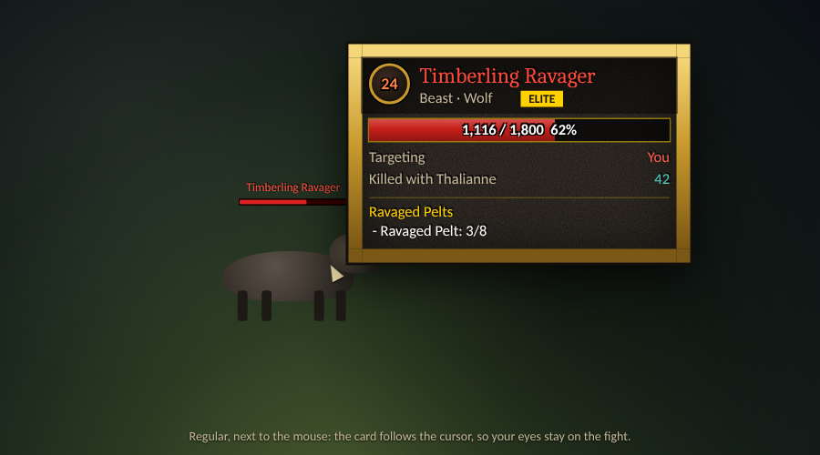
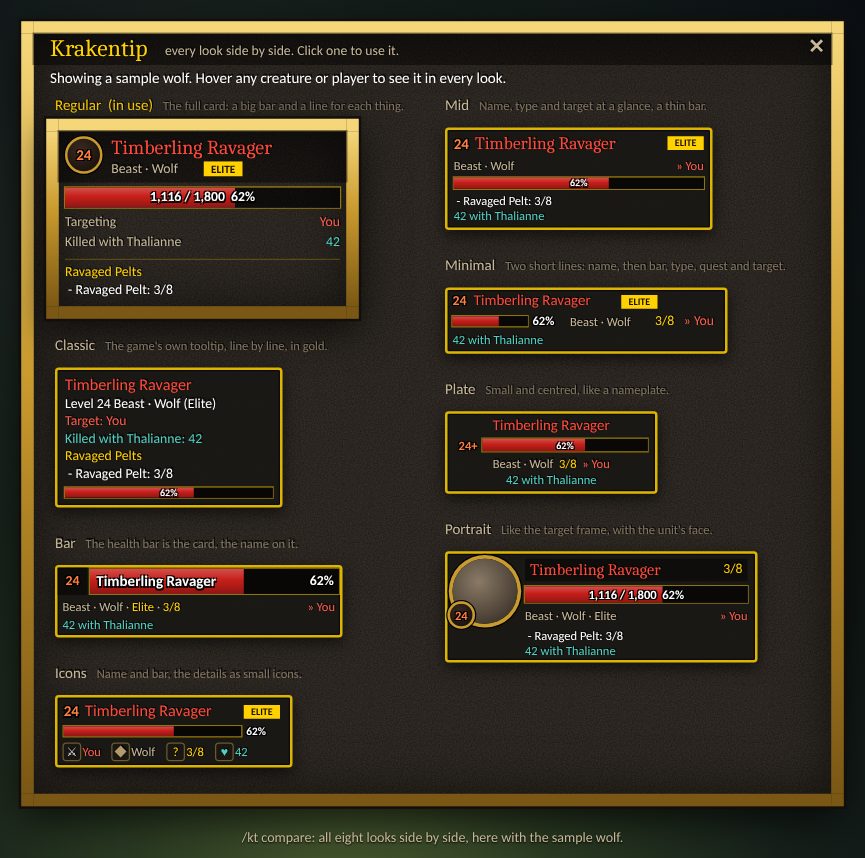
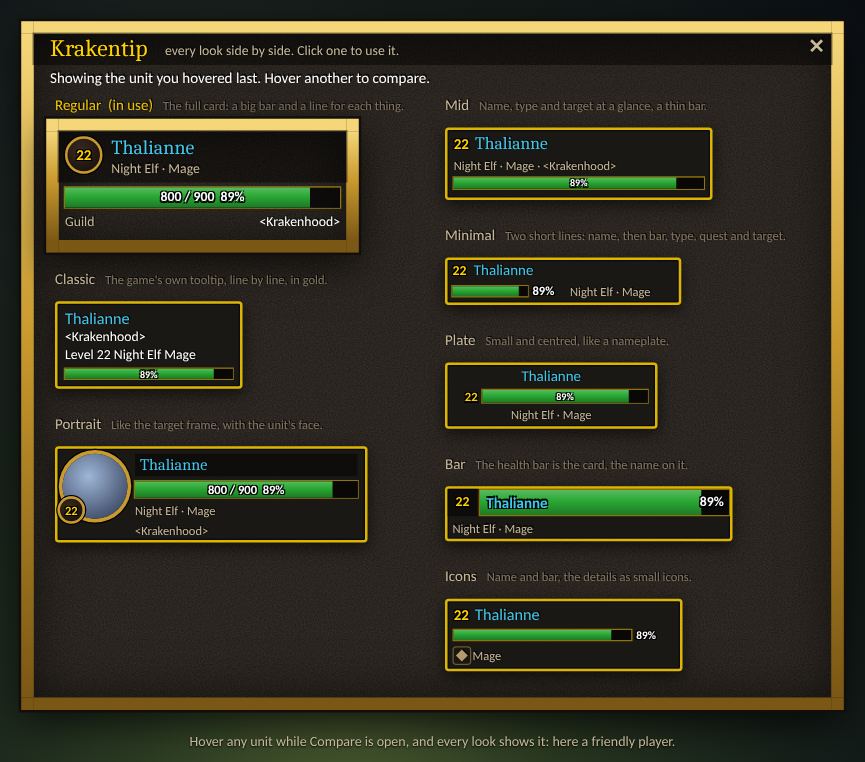
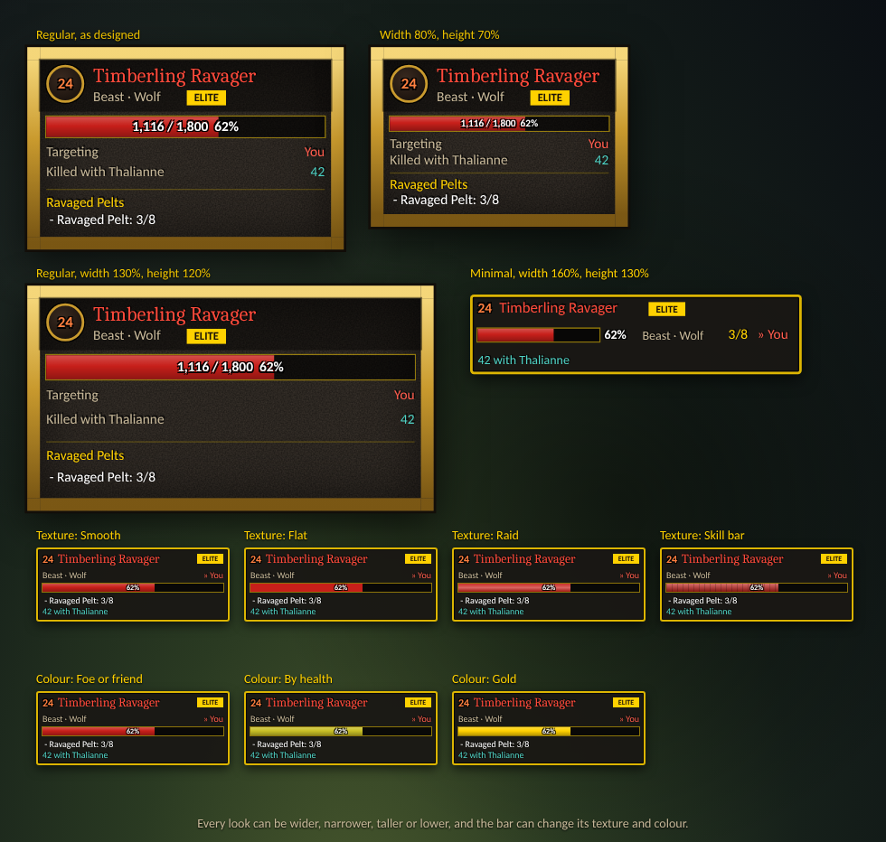
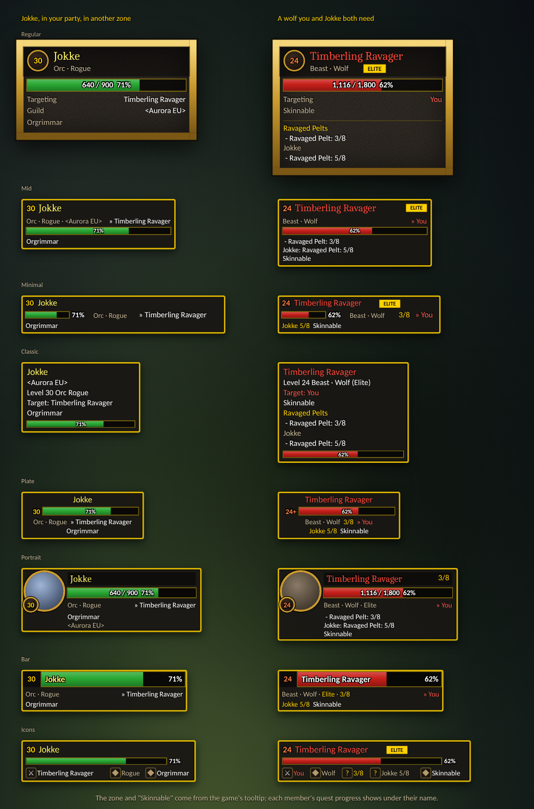
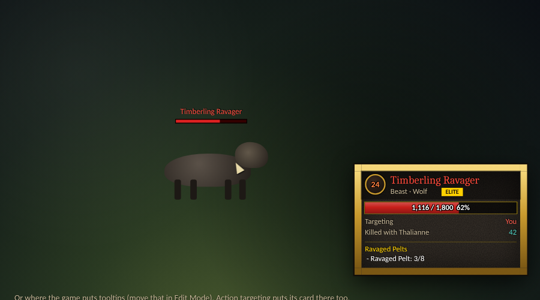
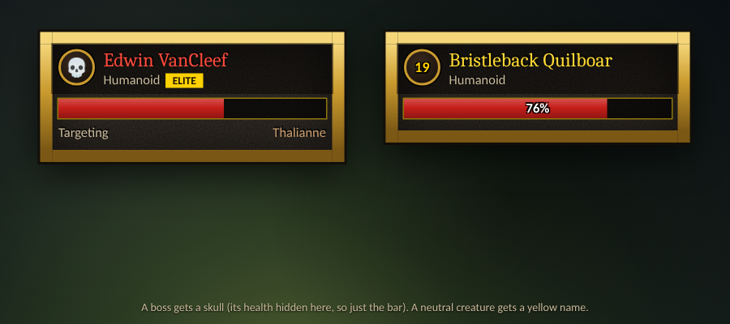
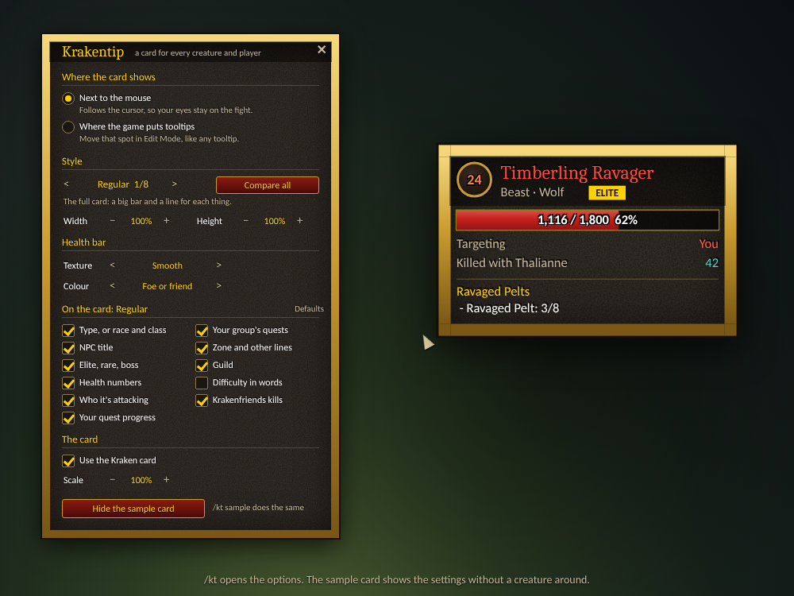

# Krakentip

Creatures and players get a card in the game's own style (gold border, dark stone, the fantasy font) instead of the game's unit tooltip, for **World of Warcraft: Forever**, like the rest of the Kraken family. Friend or foe, NPC or player: every unit gets the card. **Every other tooltip stays as it is**: items, spells, menus, buttons and bags keep the game's tooltip.

## Eight styles

| Style | What it looks like |
| --- | --- |
| **Regular** | The full card: level in a gold ring, a big bar with the numbers, a line for each thing, the quest lines. |
| **Mid** | Name, type and target at a glance, a thin bar, the quest objectives. |
| **Minimal** | Two short lines: level, name and badge; then a small bar, the type, the quest count and the target. |
| **Classic** | The game's own tooltip, line by line ("Level 24 Beast · Wolf (Elite)"), in the gold frame. |
| **Plate** | Small and centred, like a nameplate: name, level with a + for elites, bar, then type, quest count and target. |
| **Portrait** | Like the game's target frame: the unit's face in a ring, its level, a name band with the quest count, the bar. |
| **Bar** | The health bar is the card, with the name written on it; type, rank, quest count and target below. |
| **Icons** | Name and bar, then the details as small icons with a value (target, type, quest, kills, guild). |

Every style can show every field below; you choose which, per style (see **What's on the card**).

**Compare them**: `/kt compare` (or **Compare all** in the options, or shift-click the minimap button) opens a window with all eight side by side. It shows a sample wolf until you hover a unit; then every style shows that unit, and keeps it after the mouse leaves. Click a style to use it.

To switch: step through them in the options (< and >), `/kt style plate` or just `/kt plate`, or right-click the minimap button for the next one. `/kt styles` lists them.

## Width, height and the bar

Each style has its own **width** and **height** (60% to 160%), in the options or with `/kt width 0.8` and `/kt height 1.2` for the style in use. Height stretches the bar and the space between the lines; the text keeps its size. **Scale** makes the whole card bigger or smaller.

The **health bar** has a texture (Smooth, Flat, Raid, Skill bar) and a colour: foe or friend (red for what you can attack, green for the rest), by health (green, to yellow, to red as it drops) or gold.

## The card

- **Level**, coloured by how hard the creature is for you. Bosses and creatures far above you get a skull.
- **Name** in the game's colours: red for hostile, yellow for neutral, green for friendly, grey when someone else has tagged it. Players in their class colour.
- **What it is**: "Beast · Wolf", an NPC's title ("Innkeeper · Humanoid"), a player's race and class. A badge for **Elite**, **Rare**, **Rare Elite** and **Boss**.
- **Health**: red for what you can attack, green for everyone else.
- **Targeting**: who it's attacking. "You" in red when it's coming for you, players in their class colour.
- **Difficulty in words** (off by default, since the level's colour says it): Trivial, Easy, Even, Hard, Very hard or Deadly, on the Regular and Classic cards.
- **Guild** for players.
- **Your quest progress**: your objectives for this creature, or your count ("3/8") on the small styles.
- **Your group's quests**: each group member's progress, under their name, or as "Jokke 5/8" on the small styles.
- **Zone and other lines**: what else the game's tooltip says, like a party member's zone when they're somewhere else, "Skinnable" or "AFK".
- **Killed with your friend**: with [Krakenfriends](https://github.com/Krakenhood/krakenfriends) loaded, how often you two have killed this creature. It only shows when Krakenfriends is loaded and you've killed it together; the tick in the options turns it off altogether.

The card keeps itself up to date while you hover: health, who it's attacking, dead or tagged.

## What's on the card

Each style has its own list of what it shows, in the options under **On the card**, with a **Defaults** button to put it back: type (or race and class), NPC title, elite/rare/boss, health numbers, who it's attacking, your quest progress, your group's quests, zone and other lines, guild, difficulty in words, Krakenfriends kills. The name, the level and the bar always show. `/kt show group` switches one field of the style in use.

By default every style shows everything except the difficulty in words (the level's colour says it), and the small styles (Minimal, Plate, Bar, Icons) leave out the guild. Where a small style has no room on its own lines, the extra fields go on a line of their own (Minimal, Plate, Bar) or become more icons (Icons).

## Where it shows

Two choices, in the options (`/kt`) or by command:

- **Next to the mouse** (`/kt mouse`, the default). The card follows the cursor, so your eyes stay on the fight. Near the right edge of the screen it flips to the left of the cursor.
- **Where the game puts tooltips** (`/kt tooltip`). The card sits where the game's tooltip would be. Move that spot in Edit Mode, like any tooltip.

**Action targeting**: when you face a creature and the game picks it as your soft target, it shows that creature's tooltip without the mouse. Krakentip shows the card for it at the tooltip spot, and it goes when you face something else.

## Options

`/kt` opens the options window: where the card shows, its style, that style's width and height, the health bar, what's on the card and the scale. It's also under Options > AddOns > Krakentip, and the minimap button opens it (click; right-click switches the style, shift-click opens Compare).

**Show a sample card** puts a pretend Timberling Ravager on screen, so you can try the position, the style, the size and the lines without a creature around. It stays until you click again or close the options.

## Still open

Tighter versions of Minimal and Icons are being designed: see [docs/design-notes.md](docs/design-notes.md).

## How it works

The game builds unit tooltips (creatures and players) on their own path, apart from the tooltips for items, spells, menus and buttons. Krakentip only steps in on that path: the game's unit tooltip is hidden before it's drawn, and the card shows instead. The moment the game's tooltip is taken for anything else, it's left alone, so nothing else can look different.

**Secret values**: Forever can hide some numbers from addons, an enemy's health in particular. The health bar still fills, because the game lets status bars show hidden numbers. The numbers on it then show only if the game can write them itself, and stay empty otherwise. Lines that need a hidden value (who it's attacking, for example) are left out.

## Commands

| Command | What it does |
| --- | --- |
| `/kt` | Open or close the options |
| `/kt mouse` | Show the card next to the mouse |
| `/kt tooltip` | Show the card where the game puts tooltips |
| `/kt style` | Switch to the next style, or `/kt style plate` (or just `/kt plate`) |
| `/kt styles` | List the eight styles |
| `/kt compare` | All eight styles side by side; hover a unit to fill them |
| `/kt width 0.8` | This style's width (0.6 to 1.6) |
| `/kt height 1.2` | This style's height (0.6 to 1.6) |
| `/kt show group` | Show or hide a field on this style: type, title, rank, health, target, quests, group, other, guild, difficulty, friends |
| `/kt bar flat` | The bar's texture: smooth, flat, raid, skill (no name: the next one) |
| `/kt barcolor health` | The bar's colour: reaction, health, gold |
| `/kt scale 1.2` | Make the card bigger or smaller (0.6 to 1.6) |
| `/kt sample` | Show or hide the sample card |
| `/kt blizzard` | Switch between the card and the game's own unit tooltips |
| `/kt minimap` | Show or hide the minimap button |
| `/kt fonts` | Which font file each alphabet (Latin, Cyrillic, Korean, Chinese) gets |

## Install

Copy the `Krakentip` folder into the game's `Interface\AddOns` folder.

## Development

- `cd tests && npm install && npm test` runs the addon headless against a mock of the game.
- `node tools/screenshots/shots.js` hovers a few units in each style through the real code and redraws `assets/screenshots/`. The layout follows the addon; fonts, textures and the creatures are stand-ins.
