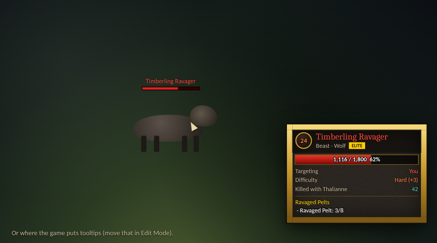
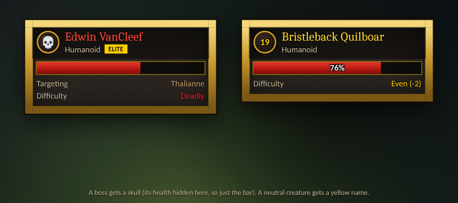
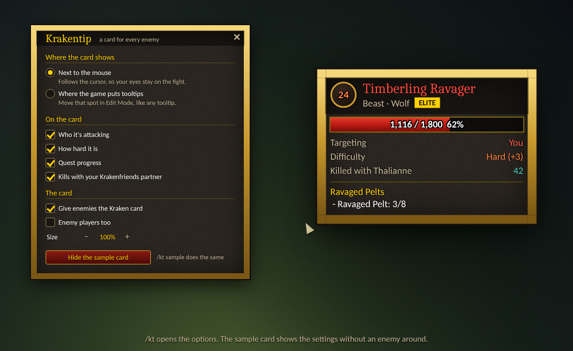

# Krakentip

Enemies get a card in the game's own style (gold border, dark stone, the fantasy font) for **World of Warcraft: Forever**, like the rest of the Kraken family. **Every other tooltip stays as it is**: items, spells, buttons, bags, friendly players and creatures all keep the game's tooltip.

## The card

- **Level** in a gold ring, coloured by how hard the creature is for you. Bosses and creatures far above you get a skull.
- **Name** in the game's colours: red for hostile, yellow for neutral, grey when someone else has tagged it.
- **Creature type and family** ("Beast · Wolf"), with a badge for **Elite**, **Rare**, **Rare Elite** and **Boss**.
- **A big health bar** with the numbers and the percentage.
- **Targeting**: who it's attacking. "You" in red when it's coming for you, other players in their class colour.
- **Difficulty**: Trivial, Easy, Even, Hard, Very hard or Deadly, with the level difference.
- **Quest progress**: the quest lines the game's tooltip shows for this creature ("Ravaged Pelts", "- Ravaged Pelt: 3/8").
- **Killed with your friend**: with [Krakenfriends](https://github.com/Krakenhood/krakenfriends) loaded, how often you two have killed this creature.

Each line can be turned off in the options.

## Where it shows

Two choices, in the options (`/kt`) or by command:

- **Next to the mouse** (`/kt mouse`, the default). The card follows the cursor, so your eyes stay on the fight. Near the right edge of the screen it flips to the left of the cursor.
- **Where the game puts tooltips** (`/kt tooltip`). The card sits where the game's tooltip would be. Move that spot in Edit Mode, like any tooltip.

## Options

`/kt` opens the options window. It's also under Options > AddOns > Krakentip.

**Show a sample card** puts a pretend Timberling Ravager on screen, so you can try the position, the size and the lines without an enemy around. It stays until you click again or close the options.

## How it works

Krakentip doesn't restyle the game's tooltip. When the game's tooltip shows an enemy, Krakentip makes it invisible and shows the card instead. The game's tooltip keeps doing its job underneath, so it still comes and goes as it always did. When the tooltip shows anything else (or hides), it's visible again, unchanged. That's why nothing else can look different.

**Secret values**: Forever can hide some numbers from addons, an enemy's health in particular. The health bar still fills, because the game lets status bars show hidden numbers. The numbers on it then show only if the game can write them itself, and stay empty otherwise. Lines that need a hidden value (who it's attacking, for example) are left out.

## Commands

| Command | What it does |
| --- | --- |
| `/kt` | Open or close the options |
| `/kt mouse` | Show the card next to the mouse |
| `/kt tooltip` | Show the card where the game puts tooltips |
| `/kt scale 1.2` | Make the card bigger or smaller (0.6 to 1.6) |
| `/kt sample` | Show or hide the sample card |
| `/kt off` | Give enemies the game's own tooltip again (`/kt on` undoes it) |

## Install

Copy the `Krakentip` folder into the game's `Interface\AddOns` folder.

## Development

- `cd tests && npm install && npm test` runs the addon headless against a mock of the game.
- `node tools/screenshots/shots.js` hovers a few creatures through the real code and redraws `assets/screenshots/`. The layout follows the addon; fonts, textures and the creatures are stand-ins.
