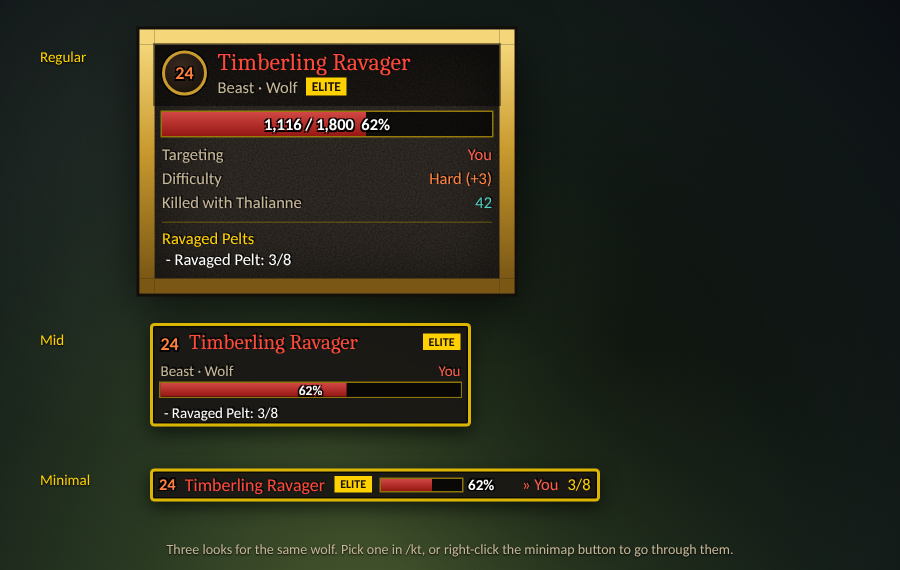
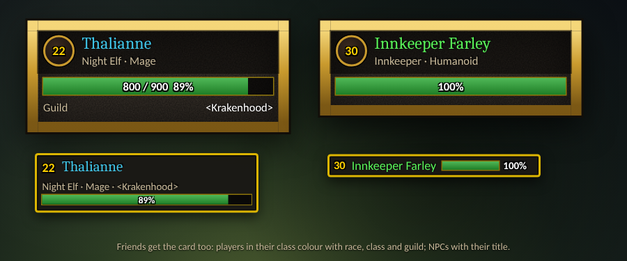
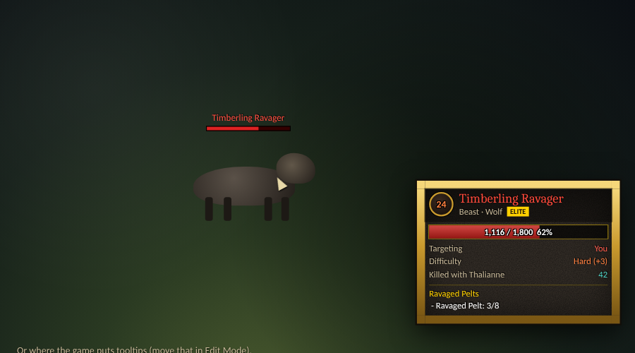
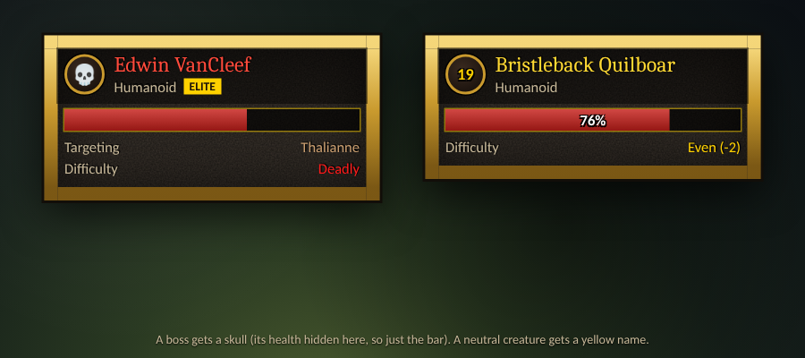
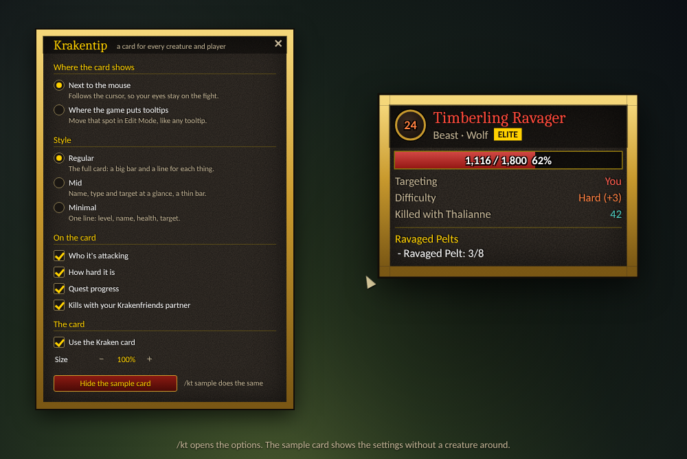

# Krakentip

Creatures and players get a card in the game's own style (gold border, dark stone, the fantasy font) instead of the game's unit tooltip, for **World of Warcraft: Forever**, like the rest of the Kraken family. Friend or foe, NPC or player: every unit gets the card. **Every other tooltip stays as it is**: items, spells, menus, buttons and bags keep the game's tooltip.

## Three styles

- **Regular**: the full card. Level in a gold ring, name, type, a big health bar with the numbers, a line each for who it's attacking, how hard it is, the guild and kills together, and the quest lines.
- **Mid**: the same at a glance. Level and name, type and target on one line, a thin bar, the quest objectives.
- **Minimal**: one line. Level, name, badge, a small bar with the percentage, who it's attacking, the quest count ("3/8").

Pick one in the options (`/kt`), with `/kt style mid`, or right-click the minimap button to go through them.

## The card

- **Level**, coloured by how hard the creature is for you. Bosses and creatures far above you get a skull.
- **Name** in the game's colours: red for hostile, yellow for neutral, green for friendly, grey when someone else has tagged it. Players in their class colour.
- **What it is**: "Beast · Wolf", an NPC's title ("Innkeeper · Humanoid"), a player's race and class. A badge for **Elite**, **Rare**, **Rare Elite** and **Boss**.
- **Health**: red for what you can attack, green for everyone else.
- **Targeting**: who it's attacking. "You" in red when it's coming for you, players in their class colour.
- **Difficulty** (Regular): Trivial, Easy, Even, Hard, Very hard or Deadly, with the level difference. Only for what you can fight.
- **Guild** for players.
- **Quest progress**: the quest lines the game's tooltip shows for this creature.
- **Killed with your friend**: with [Krakenfriends](https://github.com/Krakenhood/krakenfriends) loaded, how often you two have killed this creature.

The card keeps itself up to date while you hover: health, who it's attacking, dead or tagged.

## Where it shows

Two choices, in the options (`/kt`) or by command:

- **Next to the mouse** (`/kt mouse`, the default). The card follows the cursor, so your eyes stay on the fight. Near the right edge of the screen it flips to the left of the cursor.
- **Where the game puts tooltips** (`/kt tooltip`). The card sits where the game's tooltip would be. Move that spot in Edit Mode, like any tooltip.

## Options

`/kt` opens the options window: where the card shows, its style, its lines and its size. It's also under Options > AddOns > Krakentip, and the minimap button opens it (click; right-click switches the style).

**Show a sample card** puts a pretend Timberling Ravager on screen, so you can try the position, the style, the size and the lines without a creature around. It stays until you click again or close the options.

## How it works

The game builds unit tooltips (creatures and players) on their own path, apart from the tooltips for items, spells, menus and buttons. Krakentip only steps in on that path: the game's unit tooltip is hidden before it's drawn, and the card shows instead. The moment the game's tooltip is taken for anything else, it's left alone, so nothing else can look different.

**Secret values**: Forever can hide some numbers from addons, an enemy's health in particular. The health bar still fills, because the game lets status bars show hidden numbers. The numbers on it then show only if the game can write them itself, and stay empty otherwise. Lines that need a hidden value (who it's attacking, for example) are left out.

## Commands

| Command | What it does |
| --- | --- |
| `/kt` | Open or close the options |
| `/kt mouse` | Show the card next to the mouse |
| `/kt tooltip` | Show the card where the game puts tooltips |
| `/kt style` | Switch to the next style, or `/kt style regular`, `mid`, `minimal` |
| `/kt scale 1.2` | Make the card bigger or smaller (0.6 to 1.6) |
| `/kt sample` | Show or hide the sample card |
| `/kt blizzard` | Switch between the card and the game's own unit tooltips |
| `/kt minimap` | Show or hide the minimap button |

## Install

Copy the `Krakentip` folder into the game's `Interface\AddOns` folder.

## Development

- `cd tests && npm install && npm test` runs the addon headless against a mock of the game.
- `node tools/screenshots/shots.js` hovers a few units in each style through the real code and redraws `assets/screenshots/`. The layout follows the addon; fonts, textures and the creatures are stand-ins.
