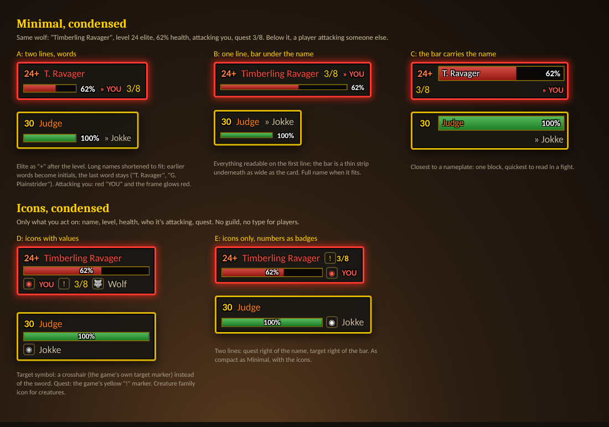

# Design notes: condensed Minimal and Icons

Status: **open**. Bernhard likes Minimal and Icons most and wants them reworked into tighter versions. Nothing below is built yet; all eight styles stay as they are until the choice is made.

The mockup's source is [condensed-proposals.html](condensed-proposals.html).

## What the condensed styles must show

Agreed:

- **Name**, coloured as now (hostile red, neutral yellow, friendly green, players in class colour).
- **Level**, coloured by difficulty.
- **Health**: the bar and the percentage, always.
- **Targeting**: who it's attacking. Not with the sword icon.
- **Quest progress**: "3/8".

Not needed: the guild.

Proposed on top:

1. Elite as **"24+"** after the level instead of the gold ELITE badge (the classic WoW mark, saves width).
2. Targeting you: a red **YOU** and a red glow on the frame, so it's noticed without reading.
3. Creature type only where there's room (Icons D), never for players.

## The five proposals

| | Layout | Notes |
| --- | --- | --- |
| **A** (Minimal) | Two lines, words only: `24+ T. Ravager` / bar, `62%`, `» YOU`, `3/8` | Closest to today's Minimal, tighter. Recommended for Minimal. |
| **B** (Minimal) | Everything on line one, a thin bar strip under it as wide as the card | Full name when it fits. |
| **C** (Minimal) | The name on the bar, nameplate-like; quest and target below | Quickest to read in a fight. |
| **D** (Icons) | Three lines: name, bar, then icons with values (target, quest, creature family) | |
| **E** (Icons) | Two lines: quest right of the name, target right of the bar | As compact as Minimal, with icons. Recommended for Icons. |

## Open questions

- **Name shortening** when the name doesn't fit. Bernhard's idea: keep the first word, initial the rest ("Timberling R."). The proposal: keep the last word, initial the earlier ones ("T. Ravager", "G. Plainstrider"), since for creatures the last word says what it is; that's also what nameplate addons such as Plater do. Short names ("Judge") stay whole either way.
- **Target symbol**: a crosshair like the game's target marker (D, E), the "»" arrow (A, B, C), or no symbol with red YOU.
- Which of A/B/C for Minimal and D/E for Icons, or whether they become new styles next to the old ones.
